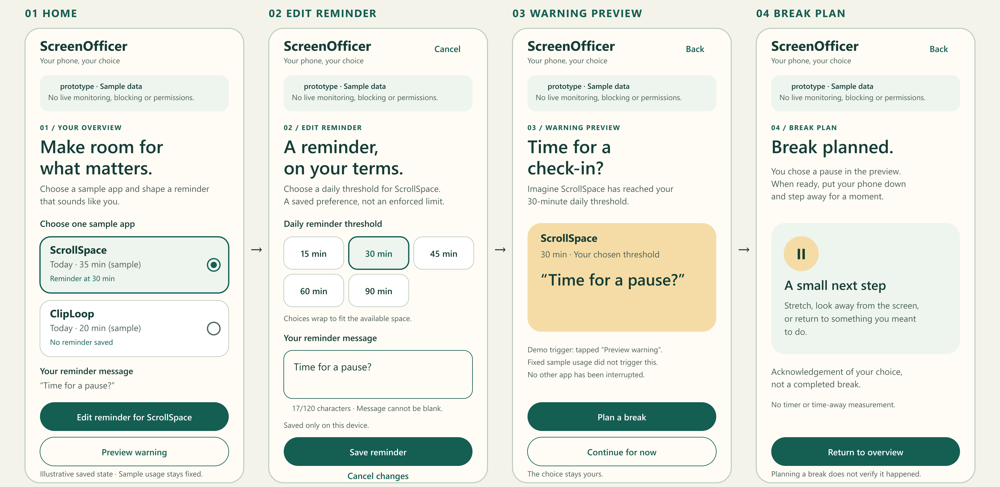

# [Screen Officer](https://github.com/paderc/IntroductionToMobileSystems)

**A customizable Android app for intentional phone use**

**Authors:** Mateusz Pstrągowski 257288, Igor Paderewski 257286

## Project canvas

**User, task and barrier — hypothesis:** An adult student using Android wants to end optional social scrolling before study or sleep, but uninterrupted feeds make elapsed time easy to miss. Prolonged use, emotional numbing and hurt are concerns to investigate; usage duration alone cannot identify harmful content.

**Value and core journey:** Keep the phone owner in control through a voluntary daily soft limit: explain access → select one app and goal → review Today → view a calm warning → choose a break or five additional minutes of app use.

**Target platform:** Android 13+; Kotlin and Jetpack Compose in Android Studio.

**Planned native scope:** Check usage when Screen Officer opens or the user taps Refresh. Warnings appear inside Screen Officer after a successful check. Background monitoring and device notifications are deferred.

**Excluded:** Hard blocking, content analysis, parental surveillance, accounts, cloud storage and treatment claims.

## Evidence and assumptions

**Evidence:** [Pieh et al. (2025)](https://link.springer.com/article/10.1186/s12916-025-03944-z) randomized 111 healthy students. A three-week smartphone-use reduction produced improvements in several self-reported outcomes, but screen time increased again afterwards. Whether Screen Officer helps users remains untested.

**Assumptions:** Students notice their goals too late, customizable warnings help them pause, and users will grant Usage Access.

**Planned later usability check:** Two voluntary, consenting adult peers outside the team will each attempt to set a 30-minute goal and choose “Take a break” unaided within 90 seconds. Record actual outcomes, anonymous observations and two improvements or justified decisions not to change. These sessions have not yet been conducted.

## Three user stories and acceptance criteria

1. **Set my goal.** As a student, I want to choose a daily limit that fits my routine.  
   **AC:** Select one app, a goal of 15–120 minutes in five-minute steps, and Gentle or Direct tone. Save retains these choices after relaunch. Invalid values cannot be saved.

2. **Notice and choose.** As a student, I want a respectful warning so I can decide whether to continue.  
   **AC:** After a successful check, fresh usage at or above the active threshold opens a warning showing the app and measured time. “Take a break” suppresses further warnings for that app today without claiming a completed break. “+5 minutes” sets a temporary threshold of current measured usage plus five minutes; the saved daily goal stays the same. This means additional app-use time, not a five-minute clock timer.

3. **Adjust without pressure.** As the phone owner, I want to review and change my goal.  
   **AC:** Today shows used/goal minutes and the last successful update. Edit and pause/resume work; paused goals produce no warnings. Goal changes reset temporary warning state. On the next check in a new local calendar day, the daily goal applies again. Confirmed Clear removes Screen Officer’s local records and settings.

## Two accessibility requirements

1. **Operate:** Controls have meaningful TalkBack labels, logical focus order and touch targets of at least 48 × 48 dp.
2. **Read:** Normal text contrast is at least 4.5:1. At 200% system font size, essential text remains readable and actions remain reachable by scrolling.

These are requirements to verify on the implemented main flow.

## Initial data and risks

**Proposed native data:** Selected app/package, dated daily usage totals, goal, tone and pause/snooze state. Store privately on-device. Retain daily totals for seven days, deleting expired records on the next app opening; retain settings until cleared. Disable backup and discard unselected-app results immediately.

Usage patterns can reveal routines. Explain access clearly and provide confirmed clearing. Collect no message content, health records, location histories, children’s data or personal interview data. Clearing local data does not erase Android’s usage history or revoke Usage Access.

Android’s [UsageStatsManager](https://developer.android.com/reference/android/app/usage/UsageStatsManager) requires special access for most usage queries. Denied, revoked or unavailable access shows **“Monitoring off.”** Unavailable or stale usage must not trigger warnings.

**Connectivity plan:** The proposed core task works offline. Seek lecturer approval for an offline-only application and complete the separate networking exercise, including request states and a fallback.

## Responsibilities and prototype

**Responsibilities:** Mateusz — prototype, README, research, main app. Igor — prototype, research, main app, idea.

**Prototype:** Four screen user-flow board

